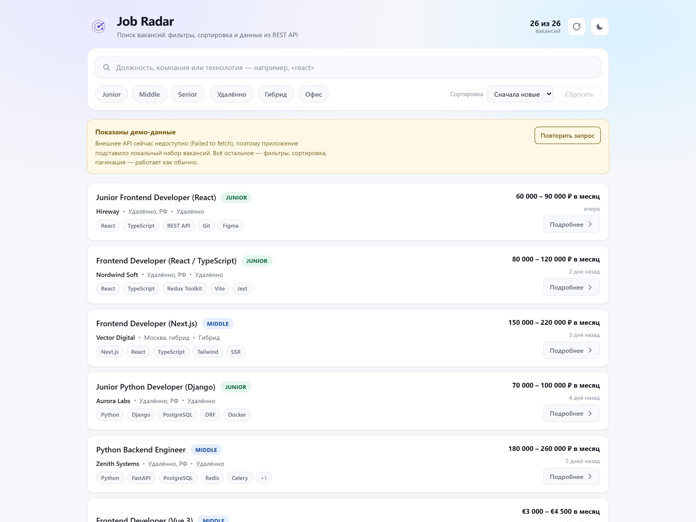
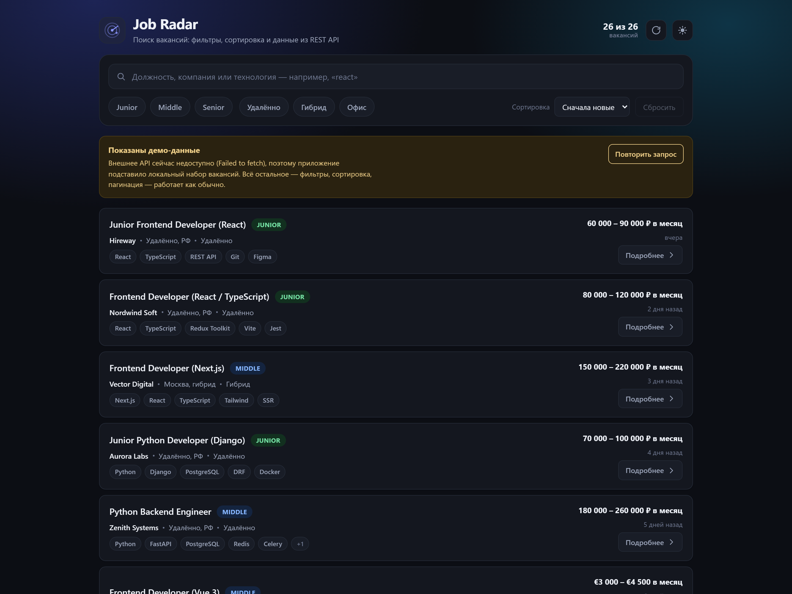
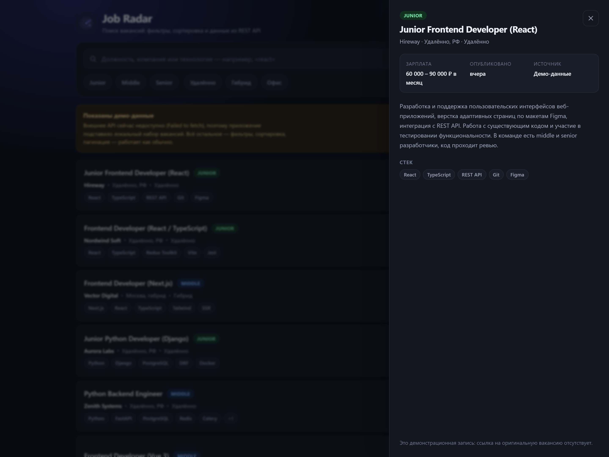
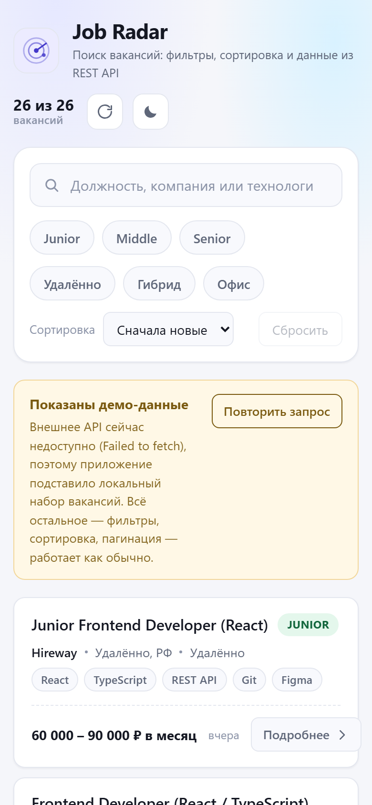

# Job Radar

Веб-приложение (SPA) для поиска IT-вакансий на **React 18**, **TypeScript** и **Vite** с подключением к публичному REST API.

🔗 **Живое демо:** [job-radar-seven-woad.vercel.app](https://job-radar-seven-woad.vercel.app)



## Основной функционал

- **Загрузка вакансий по REST API** (`arbeitnow.com`) через `fetch` с таймаутом и отменой устаревших запросов (`AbortController`).
- **Резервный офлайн-режим:** если внешнее API недоступно или блокируется по CORS/таймауту, интерфейс автоматически переключается на локальный набор данных и показывает информационный баннер.
- **Поиск с `debounce` (250 мс)** по названию должности, компании, городу и тегам стека.
- **Фильтрация и сортировка:** мультивыбор по уровню (`Junior` / `Middle` / `Senior`) и формату работы (`Remote` / `Hybrid` / `Office`), сортировка по дате и зарплате, клиентская пагинация.
- **Карточка вакансии (`drawer`):** выезжающая боковая панель с подробным описанием, поддержкой закрытия по `Esc`, клику по фону и управлением фокусом с клавиатуры.
- **Светлая и тёмная темы** на CSS-переменных (с определением системной темы и сохранением выбора).
- **Адаптивная вёрстка** для десктопов и мобильных экранов + скелетоны при загрузке.

## Интерфейс

| Тёмная тема | Детали вакансии | Мобильная версия |
| :---: | :---: | :---: |
|  |  |  |

## Технологии

- **Frontend:** React 18 (Hooks, `useReducer`), TypeScript (`strict`), HTML5, CSS3 (Custom Properties, Flexbox, Grid)
- **Сборка:** Vite
- **Тестирование и CI:** Vitest, React Testing Library (40 unit- и интеграционных тестов), GitHub Actions

## Структура проекта

```text
src/
├── api/          # Запрос к внешнему API, маппинг данных и fallback
├── components/   # UI-компоненты (список, фильтры, пагинация, drawer, скелетоны)
├── data/         # Локальный набор вакансий для резервного режима и тестов
├── hooks/        # Кастомные хуки (useJobs, useDebouncedValue)
├── lib/          # Чистые функции фильтрации, сортировки, форматирования и тем
├── state/        # Редьюсер состояния фильтров (filtersReducer)
├── styles/       # Глобальные стили, переменные тем и адаптивная сетка
└── types.ts      # Типизация доменной модели
```

## Локальный запуск

```bash
# Установка зависимостей
npm install

# Запуск dev-сервера (http://localhost:5173)
npm run dev

# Прогон тестов и проверка типов
npm run typecheck
npm run test:run

# Production-сборка
npm run build
```
